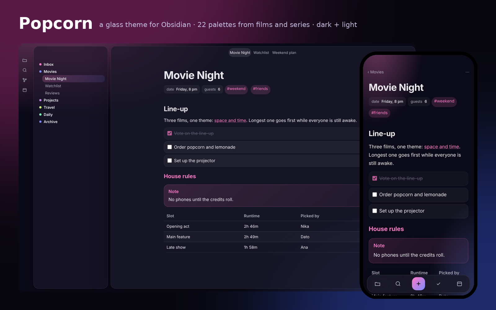
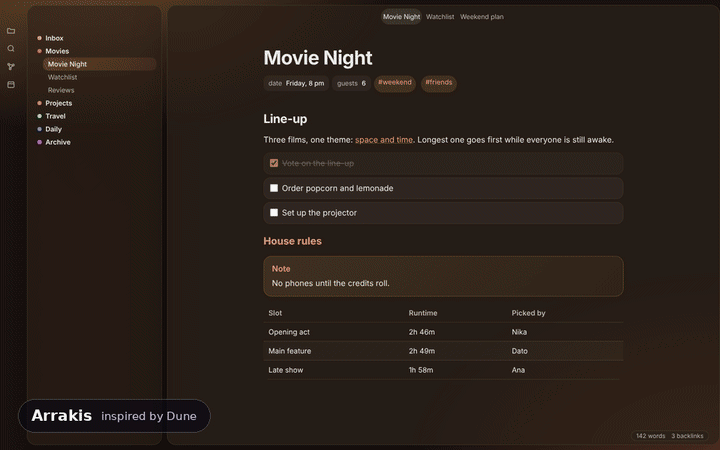
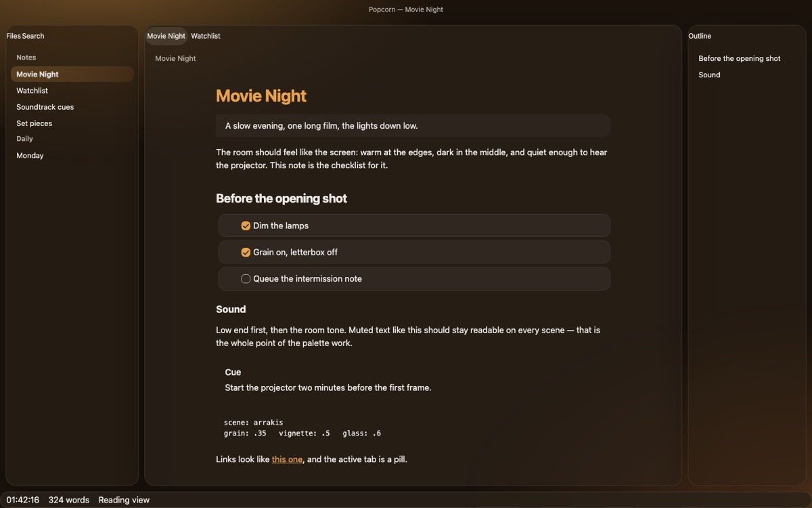
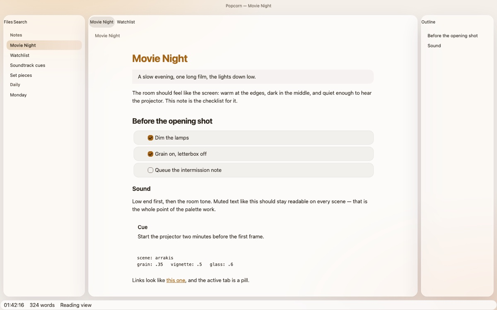
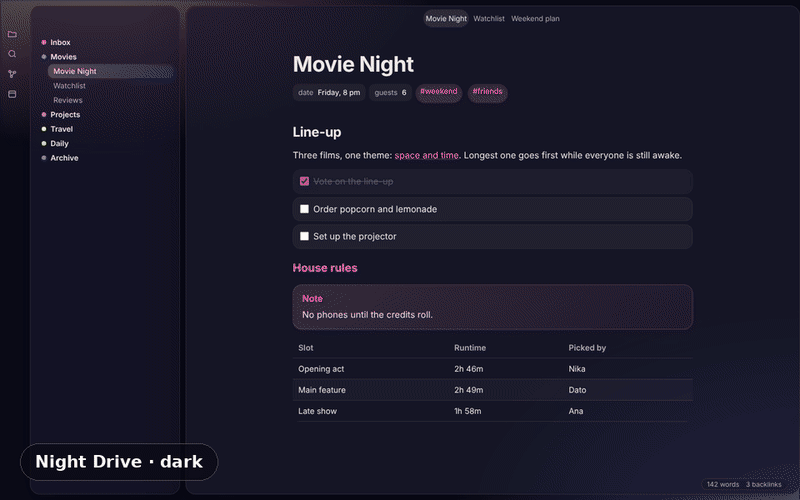
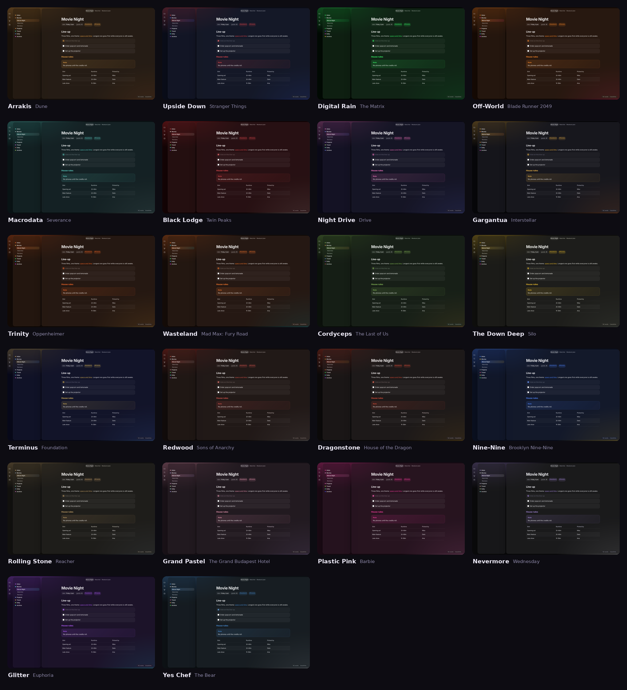
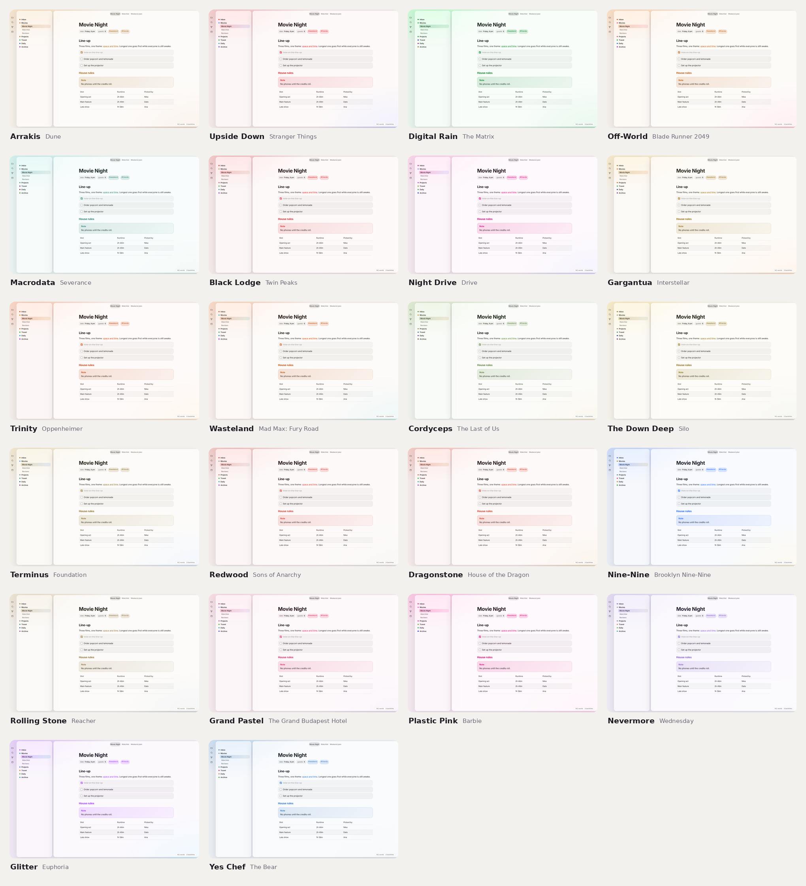
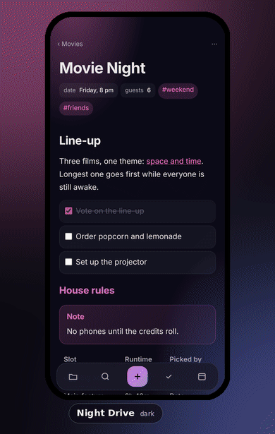
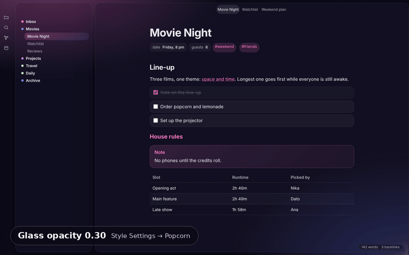

# Popcorn

> ⭐ If Popcorn makes your vault nicer, a star helps other people find it. Found a bug or want a palette? [Open an issue](https://github.com/chi-li-peppers/obsidian-popcorn/issues), I read every one.

A glass theme for Obsidian with 22 palettes inspired by films and series. Floating translucent panels, a soft glow behind your notes, dark and light versions of every palette, and a layout made for both desktop and phone.



<p align="center"></p>

## Screenshots

A few palettes at full size — the ones that show the range best.

| | |
| --- | --- |
|  |  |
|  |  |
|  |  |

[All 22 palettes in one sheet](docs/previews/all-scenes.jpg) · [On a phone](docs/previews/mobile-night-drive.jpg)

## Features

- **Glass layout**: floating panels on a glowing backdrop, centered pill tabs, floating status bar
- **22 palettes × dark and light**, all contrast-checked for readable text
- **A palette per note**: give any note its own look with the `cssclasses` property
- **Adjustable glass**: opacity and blur sliders, or solid panels for slower devices
- **Colored folders**, task cards, property chips
- **Graph view and Canvas** in the colors of your palette
- **Works with popular plugins**: Tasks, Dataview, Kanban, Calendar, Excalidraw
- **Made for mobile**: floating bottom toolbar, glass drawers, bigger tap targets

## Palettes

Every palette comes in dark and light and follows Obsidian's own light/dark setting.

<p align="center"></p>



<details>
<summary>Light versions</summary>



</details>

| Palette | Inspired by | Per-note class |
| --- | --- | --- |
| **Arrakis** | Dune | `pc-arrakis` |
| **Upside Down** | Stranger Things | `pc-upside-down` |
| **Digital Rain** | The Matrix | `pc-digital-rain` |
| **Off-World** | Blade Runner 2049 | `pc-off-world` |
| **Macrodata** | Severance | `pc-macrodata` |
| **Black Lodge** | Twin Peaks | `pc-black-lodge` |
| **Night Drive** | Drive | `pc-night-drive` |
| **Gargantua** | Interstellar | `pc-gargantua` |
| **Trinity** | Oppenheimer | `pc-trinity` |
| **Wasteland** | Mad Max: Fury Road | `pc-wasteland` |
| **Cordyceps** | The Last of Us | `pc-cordyceps` |
| **The Down Deep** | Silo | `pc-the-down-deep` |
| **Terminus** | Foundation | `pc-terminus` |
| **Redwood** | Sons of Anarchy | `pc-redwood` |
| **Dragonstone** | House of the Dragon | `pc-dragonstone` |
| **Nine-Nine** | Brooklyn Nine-Nine | `pc-nine-nine` |
| **Rolling Stone** | Reacher | `pc-rolling-stone` |
| **Grand Pastel** | The Grand Budapest Hotel | `pc-grand-pastel` |
| **Plastic Pink** | Barbie | `pc-plastic-pink` |
| **Nevermore** | Wednesday | `pc-nevermore` |
| **Glitter** | Euphoria | `pc-glitter` |
| **Yes Chef** | The Bear | `pc-yes-chef` |

## Mobile

<p align="center"></p>

## Install

**From Obsidian:** Settings → Appearance → Themes → Manage → search for **Popcorn** → Install and use.

**Manually:** download `theme.css` and `manifest.json` from the [latest release](https://github.com/chi-li-peppers/obsidian-popcorn/releases/latest) into `<vault>/.obsidian/themes/Popcorn/`, then pick it under Settings → Appearance.

## Choosing a palette

Install the [Style Settings](https://github.com/mgmeyers/obsidian-style-settings) plugin, then go to Settings → Style Settings → Popcorn. Without it, Popcorn uses **Arrakis**. Light and dark follow Obsidian's own setting (Settings → Appearance → Base color scheme).

### A different palette for one note

Add the palette's class to the note's `cssclasses` property:

```yaml
---
cssclasses: pc-night-drive
---
```

The note gets that palette's accents and a soft glow of its colors, while the rest of the app keeps your main palette.

## Settings

<p align="center"></p>

| Setting | What it does |
| --- | --- |
| Glass opacity | How see-through the panels are (1 = solid) |
| Blur | Background blur behind panels; lower it on older devices |
| Solid panels | No transparency and no blur |
| Hide background glow | Plain background color instead of the glow |
| Line width | Text column width when readable line length is on |
| Heading size | Scales all headings |
| Classic tabs | Regular tab bar instead of centered pills |
| Hide the ribbon | Hides the icon bar on the left edge (desktop) |
| Plain folders | Turns off folder colors |
| Plain tasks | Regular task list instead of cards |

Font size is set in Obsidian itself: Settings → Appearance → Font size.

## Performance

Glass effects use background blur, which takes some GPU power. If Obsidian feels slow, lower **Blur** or turn on **Solid panels**. Popcorn also switches blur off when your system asks for reduced transparency.

## Development

`theme.css` is generated. Edit `src/base.css` (layout and styling), `src/settings.yml` (Style Settings) or the palette list in `src/gen.py`, then run:

```bash
python3 src/gen.py
```

Palettes are defined by a dark base and two accents; light versions, text colors, folder colors and contrast-safe accents are derived automatically. To release, bump `version` in `manifest.json` and push to `main`: a release with attested files is created automatically.

## Disclaimer

Popcorn is an independent fan project. It is not affiliated with, endorsed by, or sponsored by any film studio, streaming service, or rights holder. Film and series titles are mentioned only to describe the color palettes that inspired each variant. All titles and trademarks belong to their respective owners, including Warner Bros., Netflix, HBO, Apple, Universal, Amazon and others. No logos, images, or other copyrighted material from these works are included.

If you are a rights holder and have a concern, please [open an issue](https://github.com/chi-li-peppers/obsidian-popcorn/issues) and it will be addressed promptly.

## License

[MIT](LICENSE) © 2026 David ([chi-li-peppers](https://github.com/chi-li-peppers))

⭐ Like it? [Star the repo](https://github.com/chi-li-peppers/obsidian-popcorn) · Ideas and bugs: [issues](https://github.com/chi-li-peppers/obsidian-popcorn/issues)
